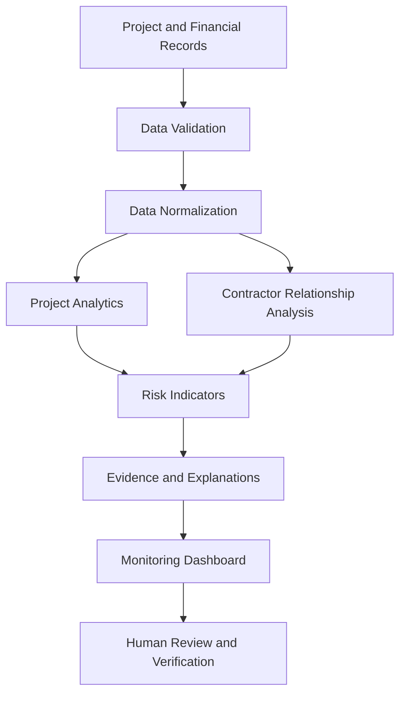

# SATARK-MPLADS
### AI-Powered Public Infrastructure Monitoring and Risk Analysis

[](https://satark-mplads.vercel.app/)

SATARK-MPLADS is an AI-powered decision-support platform designed to improve the monitoring, transparency, and accountability of public development projects under the Members of Parliament Local Area Development Scheme (MPLADS).

The platform aims to help monitoring authorities examine project information, identify unusual patterns, investigate potential irregularities, and prioritize projects that may require closer inspection.

Rather than replacing existing government monitoring systems or human decision-makers, SATARK is intended to serve as an intelligence layer that organizes evidence and supports more informed decisions.

> **Project objective:** Transform project-level information into explainable risk indicators and actionable monitoring insights.

## Table of Contents

- [Problem Statement](#-problem-statement)
- [Solution Overview](#-solution-overview)
- [Key Features](#-key-features)
- [Technical Architecture](#-technical-architecture)
- [Technology Stack](#-technology-stack)
- [Core Analytical Concepts](#-core-analytical-concepts)
- [Data Processing Workflow](#-data-processing-workflow)
- [Security and Responsible AI](#-security-and-responsible-ai)
- [Getting Started](#-getting-started)
- [Environment Configuration](#-environment-configuration)
- [Deployment](#-deployment)
- [Testing and Validation](#-testing-and-validation)
- [Limitations](#-limitations)
- [Future Enhancements](#-future-enhancements)
- [Project Information](#-project-information)

## 🎯 Problem Statement

Public infrastructure projects involve multiple stages, including proposal, approval, fund allocation, execution, inspection, and completion.

Monitoring these projects can be challenging when information is distributed across records, financial reports, contractor details, and progress updates.

Potential issues include:

- Delays between planned and reported completion dates.
- Differences between estimated and reported project expenditure.
- Repeated associations between contractors and projects.
- Duplicate or suspiciously similar project records.
- Incomplete or inconsistent project documentation.
- Difficulty prioritizing projects for field inspection.

These patterns do not automatically establish fraud or misconduct. They indicate areas that may deserve additional verification.

## 💡 Solution Overview

SATARK provides a centralized interface for examining infrastructure project information and identifying potential monitoring risks.

The intended analytical workflow is:

1. **Collect:** Obtain project, expenditure, contractor, and progress information from available records.
2. **Normalize:** Convert source information into consistent formats for comparison.
3. **Analyze:** Examine project attributes, timelines, expenditure patterns, and relationships.
4. **Identify:** Flag unusual patterns using implemented analytical rules or models.
5. **Explain:** Present the evidence and factors associated with a risk indicator.
6. **Prioritize:** Help monitoring personnel decide which projects require closer review.
7. **Verify:** Support human investigation using original records and additional evidence.

The platform is designed to support evidence-based monitoring rather than automatically make allegations or final administrative decisions.

## ✨ Key Features

### 1. Centralized Project Monitoring

Provides a common interface for examining project information, status, progress, and related records.

**Technical purpose:**
- Organize project-level information.
- Make project attributes easier to review.
- Support navigation between project records and monitoring insights.

### 2. Anomaly and Risk Analysis

Aims to identify unusual values or patterns in project records, depending on the data and analytical functionality implemented.

Potential indicators include:
- Unusual expenditure compared with similar projects.
- Unexpected differences between planned and actual timelines.
- Repeated or conflicting project information.
- Inconsistent contractor or project attributes.

An anomaly is a signal for investigation, not proof of wrongdoing.

### 3. Contractor Relationship Analysis

Examines connections between contractors and public development projects.

A relationship-analysis approach can represent:
- Contractors as entities.
- Projects as entities.
- Contractor-to-project assignments as relationships.
- Shared attributes or repeated associations as potential links for review.

This can help reviewers understand complex relationships that are difficult to identify from isolated records.

*Include this feature as implemented only if the application actually constructs or displays these relationships.*

### 4. Risk-Based Monitoring

Helps prioritize projects based on available risk indicators.

A risk indicator may combine factors such as expenditure deviation, delays, data inconsistencies, and relationship patterns. The exact formula must match the implementation.

The purpose is to help allocate inspection resources efficiently, not to replace expert review.

### 5. Evidence-Oriented Investigation

Supports the review of underlying project information associated with a flagged issue.

A useful investigation workflow should let reviewers understand:
- Which project was flagged.
- What indicator triggered the flag.
- Which data points support the indicator.
- What information is missing.
- What additional verification is required.

### 6. Visual Analytics and Reporting

Where supported by the application, dashboards and visualizations can help users review project status, risk distributions, and monitoring priorities.

Charts should communicate the source and date of the data and distinguish observed values from estimates or predictions.

## 🏗️ Technical Architecture

SATARK can be understood as a layered application. The diagram below describes the logical architecture; it does not imply that every layer is already implemented as a separate service.



### Layer 1: User Interface

The frontend presents project information, analytical results, and monitoring workflows.

Its responsibilities include:
- Rendering pages and dashboard components.
- Collecting user input.
- Displaying project records and analysis results.
- Managing navigation and interactive interface states.
- Communicating with the application's data and service layers.

The deployed interface contains Next.js framework assets and references an authentication provider. Confirm the source code before documenting the exact authentication implementation. 

### Layer 2: Application and Service Logic

This layer handles application workflows, validates input, coordinates data access, and invokes analytical or AI services where implemented.

Depending on the actual repository, this logic may run inside Next.js server components, route handlers, server actions, external services, or client-side modules.

These alternatives should not be presented as existing backend components until verified.

### Layer 3: Data Processing and Analytics

This layer is responsible for preparing project information for analysis.

Typical operations include:
- Checking required fields.
- Standardizing dates, amounts, and identifiers.
- Detecting missing or inconsistent values.
- Comparing project attributes.
- Generating risk indicators.
- Preparing results for visualization.

### Layer 4: AI and Analytical Services

AI services, if configured, may help interpret project information or generate explanations. Statistical rules or machine-learning models may identify unusual patterns.

The README should identify the exact model, API, and algorithm used by the project rather than assuming every analysis is AI-generated.

### Layer 5: Data Storage and External Integrations

The application may use persistent storage, external APIs, uploaded files, or sample datasets.

Document only the storage provider, APIs, and data sources that are actually configured in the repository. If the application currently uses demonstration data, state that explicitly.

## 🛠️ Technology Stack

The deployed website provides evidence of a Next.js-based frontend. The following table separates the publicly observable technology from details that need source-code verification.

| Component | Technology or status |
|---|---|
| Frontend framework | Next.js |
| UI rendering | React-based framework |
| Styling | Tailwind CSS classes are present in the deployed output |
| Deployment | Vercel |
| Authentication | An authentication provider is referenced; exact provider and configuration require verification |
| AI/LLM integration | Document the exact SDK, model, and API used |
| Backend | Verify from route handlers, server actions, or service directories |
| Database | Verify from configuration and database client dependencies |
| Data analysis | Document the actual libraries and algorithms used |
| Version control | Git and GitHub, if used in the project workflow |

### Why these technologies matter

**Next.js:** A React framework that supports routing, server-side rendering, and server-side application functionality.

**React:** Supports reusable UI components and interactive interfaces.

**Tailwind CSS:** Provides utility classes for implementing consistent layouts, spacing, colors, and responsive styling.

**Vercel:** Hosts the deployed web application and can support automated deployments from a connected Git repository.

Other technologies should be added after checking the repository's `package.json`, lockfile, configuration files, and source code.

## 🧠 Core Analytical Concepts

The following concepts describe potential analytical approaches for SATARK. Include them as implemented capabilities only when the code supports them.

### 1. Data Validation

Before analysis, incoming records should be checked for completeness and consistency.

Examples:
- Missing project identifiers.
- Invalid dates.
- Negative or malformed expenditure values.
- Duplicate identifiers.
- Inconsistent contractor names.

Validation helps prevent unreliable records from producing misleading insights.

### 2. Anomaly Detection

An anomaly is a data point or pattern that differs substantially from expected behavior.

For example, a project whose expenditure is unusually high relative to comparable projects may be flagged for review.

Possible approaches include:
- Rule-based thresholds.
- Statistical deviation analysis.
- Interquartile range (IQR).
- Isolation Forest.
- Other machine-learning models, if implemented and evaluated.

A possible statistical baseline is:

\[
z = \frac{x-\mu}{\sigma}
\]

Where:
- \(x\) is the observed value.
- \(\mu\) is the reference mean.
- \(\sigma\) is the reference standard deviation.

A large absolute z-score can indicate an unusual observation when the method's assumptions are appropriate. This is an illustrative technique, not a claim that SATARK currently uses z-scores.

### 3. Contractor Network Analysis

A relationship graph can model contractors and projects as nodes connected by assignment or participation edges.

For example:

```text
Contractor A ── Project 101
      │
      └──────── Project 204

Contractor B ── Project 204
```

Graph analysis can help reviewers identify shared projects, repeated associations, or unusually dense connections.

However, a shared contractor or a repeated relationship is not itself evidence of collusion. Such findings require context and independent verification.

### 4. Risk Scoring

If the application combines several indicators into a single score, the scoring method should be documented.

An illustrative weighted model is:

\[
R = \sum_{i=1}^{n} w_i s_i
\]

Where:
- \(R\) is the combined risk indicator.
- \(s_i\) is a normalized risk factor.
- \(w_i\) is the weight assigned to that factor.
- \(n\) is the number of factors.

This model is meaningful only when the factors, normalization, weights, and handling of missing data are defined.

If the application uses fixed rules rather than a statistical model, describe those rules directly instead of calling the system predictive AI.

## 🔄 Data Processing Workflow

A reliable analytical workflow should follow these stages:

1. **Data ingestion:** Receive records from a verified source or supported upload mechanism.
2. **Schema validation:** Check that required fields are present and correctly typed.
3. **Normalization:** Standardize identifiers, dates, monetary values, and category labels.
4. **Quality checks:** Identify duplicates, missing fields, and inconsistent records.
5. **Feature preparation:** Derive relevant attributes, such as duration, expenditure deviation, or contractor-project relationships.
6. **Analysis:** Run the actual configured rules, statistics, or models.
7. **Result generation:** Produce flags, scores, or explanations supported by the analysis.
8. **Presentation:** Display results in the user interface.
9. **Human verification:** Review source records before making decisions.

The precise sequence should be updated to match the application's real execution flow.

## 🔐 Security and Responsible AI

Public infrastructure monitoring involves potentially sensitive administrative and financial information.

Recommended engineering practices include:

- Keep API keys and private credentials on the server.
- Store secrets in environment variables rather than source code.
- Validate and sanitize untrusted input.
- Apply access controls to sensitive records and administrative actions.
- Restrict data access according to user roles where role-based authorization is implemented.
- Avoid exposing personal or confidential information in logs.
- Preserve source references for flagged records.
- Make risk indicators explainable and reviewable.
- Treat AI-generated outputs as suggestions that require verification.
- Avoid describing an individual or contractor as fraudulent solely because an anomaly was detected.

Security features should be described as implemented only after testing the relevant controls.

## 🚀 Getting Started

### Prerequisites

Install the following tools if they match the repository's actual setup:

- Node.js version supported by the project.
- npm, or the package manager specified by the lockfile.
- Git.
- A code editor such as Visual Studio Code.

### 1. Clone the repository

```bash
git clone https://github.com/pushkar2007/Satark-MPLADS.git
cd Satark-MPLADS
```

### 2. Install dependencies

For an npm-based project:

```bash
npm install
```

If the repository uses another package manager, follow its lockfile and installation instructions.

### 3. Configure environment variables

Check the project documentation and environment-variable references to identify the required configuration.

Create a local `.env.local` file if required by the application.

Do not commit credentials, API keys, access tokens, or production secrets to GitHub.

### 4. Run the development server

For a standard Next.js application with the usual npm script:

```bash
npm run dev
```

Open `http://localhost:3000` if that is the port configured by the application.

### 5. Create a production build

If the project's scripts support it:

```bash
npm run build
npm run start
```

Review the actual `package.json` scripts before using these commands.

## ⚙️ Environment Configuration

The following is a documentation template, not a declaration of the project's existing variables.

| Variable | Purpose |
|---|---|
| `GEMINI_API_KEY` | Only if the application calls the Gemini API |
| Database connection URL | Only if a database is configured |
| Authentication secrets | Only if the selected authentication provider requires them |
| External API credentials | Only for configured integrations |

Use the exact variable names referenced in the source code. Document whether each is required, optional, or needed only for development.

Never publish real secret values in the README.

## ☁️ Deployment

Live application: [SATARK-MPLADS](https://satark-mplads.vercel.app/)

A typical Vercel deployment workflow is:

1. Push the application source to GitHub.
2. Import the repository into Vercel.
3. Configure the required build settings.
4. Add necessary environment variables through the deployment dashboard.
5. Deploy the application.
6. Test the deployed routes, API integrations, authentication, and key workflows.

The exact build command, output configuration, and environment variables depend on the repository's setup.

## 🧪 Testing and Validation

Testing should verify both software behavior and the reliability of analytical outputs.

### Application tests
- Verify navigation and page rendering.
- Test forms and input validation.
- Confirm loading, empty, and error states.
- Test supported authentication and authorization flows.
- Check that the production build completes successfully.

### Data and analytical tests
- Test records with missing values.
- Test duplicate and inconsistent records.
- Check calculations against manually verified examples.
- Confirm that flagged records include an understandable explanation.
- Evaluate anomaly detection against labelled examples if available.
- Check for false positives and false negatives.

Do not report test coverage, accuracy, precision, recall, or other performance metrics unless they have actually been measured.

## ⚠️ Limitations

- The quality of analysis depends on the completeness, reliability, and freshness of the source data.
- Unusual expenditure or contractor relationships do not prove fraud.
- Predictive performance cannot be established without appropriate validation data.
- Demonstration data must not be presented as verified government records.
- External data integrations may require authorization, suitable APIs, and data-quality checks.
- Human review is necessary before administrative or investigative action.
- Production readiness depends on security testing, access-control validation, operational monitoring, and reliability testing.

## 🔮 Future Enhancements

Potential improvements, subject to feasibility and data availability, include:

- Integrations with authorized public project-data sources.
- Explainable and validated anomaly-detection models.
- Interactive contractor-project relationship graphs.
- Project lifecycle timelines and risk history.
- Geospatial analysis of project locations.
- Evidence-linked investigation reports.
- Role-based workflows and audit trails.
- Evaluation dashboards for measuring model quality.
- Automated notifications for newly detected monitoring risks.

These are proposed improvements and should not be interpreted as features already deployed.

## 👨‍💻 Project Information

**Project:** SATARK-MPLADS  
**Developer:** Pushkar Dilip Pathare  
**Academic specialization:** Computer Science and Engineering — Artificial Intelligence and Data Science  
**Live demo:** https://satark-mplads.vercel.app/  
**Repository:** https://github.com/pushkar2007/Satark-MPLADS

## 📌 Disclaimer

SATARK-MPLADS is a technology project intended to support public infrastructure monitoring and evidence-based decision-making. Risk indicators are not conclusive evidence of fraud or misconduct. Any findings must be validated against reliable source records and reviewed by authorized personnel.

---

**Contributions and technical feedback are welcome.**
